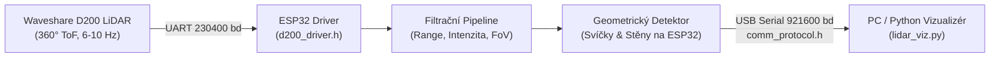

# Komplexní Technická Dokumentace: LiDAR Detekce, Stabilní Mapování a Relokalizace Robota
## Soutěžní Projekt Kybernoid 27 / RoboRAVE – Autonomní Vyhledávání a Hašení Svíček
**Verze systému:** v12 (`lokalizace-v12-automaticky-360-rozhled-v-poli`)  
**Hardware:** ToF LiDAR Waveshare D200, mikrokontrolér ESP32 (Xtensa Dual-Core)  
**Komunikační rozhraní:** USB Serial UART @ 921 600 baud  
**Zpracování a vizualizace:** Python 3 / Pygame / NumPy  

---

## Obsah
1. [Úvod a Soutěžní Kontext (Kybernoid 27 / RoboRAVE)](#1-úvod-a-soutěžní-kontext-kybernoid-27--roborave)
2. [Fyzická Realita Hřiště a Geometrická Pravidla](#2-fyzická-realita-hřiště-a-geometrická-pravidla)
3. [Hardwarová Architektura a Low-Level Zpracování na ESP32](#3-hardwarová-architektura-a-low-level-zpracování-na-esp32)
   - 3.1 [ToF LiDAR Waveshare D200](#31-tof-lidar-waveshare-d200)
   - 3.2 [Filtrační pipeline na ESP32](#32-filtrační-pipeline-na-esp32)
   - 3.3 [Geometrická detekce svíček a stěn na mikrokontroléru](#33-geometrická-detekce-svíček-a-stěn-na-mikrokontroléru)
   - 3.4 [Binární komunikační protokol UART](#34-binární-komunikační-protokol-uart)
4. [Dvouvrstvé Stabilní Mapování (StableFieldModel)](#4-dvouvrstvé-stabilní-mapování-stablefieldmodel)
   - 4.1 [Exponenciální vyhlazování (EMA) a perzistence klastrů](#41-exponenciální-vyhlazování-ema-a-perzistence-klastrů)
   - 4.2 [Stěnový koridor a potlačení parazitních odrazů](#42-stěnový-koridor-a-potlačení-parazitních-odrazů)
   - 4.3 [Syntetická rekonstrukce stíněných svíček](#43-syntetická-rekonstrukce-stíněných-svíček)
5. [Hierarchické Geometrické Kotvy a Relokalizace Robota (RobotLocalizer)](#5-hierarchické-geometrické-kotvy-a-relokalizace-robota-robotlocalizer)
   - 5.1 [Invariantní matice vzdáleností](#51-invariantní-matice-vzdáleností)
   - 5.2 [Hierarchie kotev (Primární, Sekundární, Záložní)](#52-hierarchie-kotev-primární-sekundární-záložní)
   - 5.3 [Trojúhelníková shoda (Triangle Invariant Matching)](#53-trojúhelníková-shoda-triangle-invariant-matching)
   - 5.4 [Výpočet translace, rotace a eliminace driftu](#54-výpočet-translace-rotace-a-eliminace-driftu)
   - 5.5 [Deadband klidový zámek (eliminace mikroskopického jitteru)](#55-deadband-klidový-zámek-eliminace-mikroskopického-jitteru)
6. [Globální Mapa Celého Hřiště (GlobalFieldMap)](#6-globální-mapa-celého-hřiště-globalfieldmap)
   - 6.1 [Transformace do absolutních souřadnic pole](#61-transformace-do-absolutních-souřadnic-pole)
   - 6.2 [Adaptivní usazení obdélníku hřiště (2.4 m × 3.5 m)](#62-adaptivní-usazení-obdélníku-hřiště-24-m--35-m)
   - 6.3 [Dynamické přepínání 180° startovního kuželu na 360° rozhled](#63-dynamické-přepínání-180-startovního-kuželu-na-360-rozhled)
   - 6.4 [Striktní validace soutěžních pravidel v reálném čase](#64-striktní-validace-soutěžních-pravidel-v-reálném-čase)
7. [Detailní Rozbor Grafického Uživatelského Rozhraní](#7-detailní-rozbor-grafického-uživatelského-rozhraní)
   - 7.1 [Hlavní obrazovka systému (Snímek 2026-10-18 13-42-21)](#71-hlavní-obrazovka-systému-snímek-2026-10-18-13-42-21)
   - 7.2 [Panel 1: Živý radar (senzorová telemetrie)](#72-panel-1-živý-radar-senzorová-telemetrie)
   - 7.3 [Panel 2: Původní referenční etalon (zamčená geometrie)](#73-panel-2-původní-referenční-etalon-zamčená-geometrie)
   - 7.4 [Panel 3: Relokalizační shoda v poli (kotvy a pose tracking)](#74-panel-3-relokalizační-shoda-v-poli-kotvy-a-pose-tracking)
   - 7.5 [Spodní sekce: Obdélník hřiště, geometrická pravidla a telemetrie](#75-spodní-sekce-obdélník-hřiště-geometrická-pravidla-a-telemetrie)
8. [Galerie a Evoluce Systému v Obrazech](#8-galerie-a-evoluce-systému-v-obrazech)
9. [Operátorský Manuál a Klávesové Zkratky](#9-operátorský-manuál-a-klávesové-zkratky)
10. [Diagnostika a Řešení Mezních Situací](#10-diagnostika-a-řešení-mezních-situací)

---

## 1. Úvod a Soutěžní Kontext (Kybernoid 27 / RoboRAVE)

Úkolem autonomního robota v kategorii hašení ohně (soutěže Kybernoid / RoboRAVE) je v časovém limitu lokalizovat, bezpečně objet a zhasnout (pomocí ventilátoru či stlačeného vzduchu) **4 hořící svíčky** rozmístěné na hracím poli o rozměrech **2,4 m × 3,5 m** (nebo alternativně 3,5 m × 2,4 m v závislosti na startovní zdi).

Klíčové technické výzvy úlohy:
1. **Vysoce lesklý a černý povrch hřiště:** Způsobuje pohlcování či zrcadlení paprsků optických senzorů.
2. **Kombinace překážek:** Svíčky jsou kryty bílými plastovými deskami o nominální šířce 300 mm. Některé desky stojí samostatně, jiné tvoří pravé úhly (L-rohy) nebo uzavřené kapsy (U-boxy).
3. **Přesně 1 svíčka v otevřeném prostoru:** Z celkových 4 svíček je vždy jedna svíčka umístěna zcela volně v poli bez jakékoliv stínící stěny. Ostatní tři svíčky jsou chráněny stěnami.
4. **Drift odometrie:** Hladký podklad hřiště způsobuje prokluz pohonných kol. Běžná kolová odometrie akumuluje během několika vteřin chybu v řádu desítek centimetrů a desítek stupňů. Robot se proto **nesmí spoléhat na enkódery kol**, nýbrž musí provádět **kontinuální absolutní relokalizaci** z prostorových dat LiDARu.

Tento projekt implementuje kompletní autonomní lokalizační a detekční stack, rozdělený na real-time embedded detekci na čipu **ESP32** (C++ / PlatformIO) a robustní prostorovou relokalizaci s mapováním na nadřazeném počítači (**Python 3**).

---

## 2. Fyzická Realita Hřiště a Geometrická Pravidla

Pochopení fyzického rozložení arény je základním předpokladem pro navržení spolehlivých deterministických algoritmů. Následující fotografie zachycuje reálné soutěžní pole:


*Obrázek 1: Fyzická aréna soutěže. V popředí je vidět volná svíčka (černý válec na bílém podstavci s koncentrickými kruhy), vlevo vzadu svíčka za samostatnou bílou stěnou a vpravo svíčka krytá trojicí stěn tvořících U-box.*

### Specifikace prvků na hřišti:
- **Svíčky:** Voskové/olejové svíčky na válcových tělech o vnějším průměru $D \approx 45\text{ až }55\text{ mm}$, usazené na bílých soustředných kruzích.
- **Stínící stěny:** Bílé plastové panely vysoké cca 30 cm, tloušťky 3–5 mm, usazené v dřevěných patkách. Nominální délka desky je **300 mm** ($L \in [280, 330]\text{ mm}$).
- **Vzdálenost svíčky od stěny:** Pokud je svíčka u stěny, střed svíčky je vzdálen $120\text{ až }220\text{ mm}$ od vnitřní plochy desky.
- **Minimální rozestup mezi svíčkami:** Pravidla stanovují, že žádné dvě svíčky nesmí být blíže než **800 mm** od sebe.
- **Obvodové mantinely:** Bílé desky ohraničující prostor $2400\text{ mm} \times 3500\text{ mm}$.

---

## 3. Hardwarová Architektura a Low-Level Zpracování na ESP32

Celý řetězec zpracování signálu začíná na úrovni mikrokontroléru ESP32, který obsluhuje samotný LiDAR a v reálném čase provádí předzpracování a geometrickou detekci.



### 3.1 ToF LiDAR Waveshare D200
LiDAR Waveshare D200 využívá technologii **Time-of-Flight (ToF)**:
- **Vzorkovací frekvence:** 3000 až 4500 měření/s (cca 400–600 bodů na jednu 360° otáčku při 7 Hz).
- **Mrtvá zóna:** Minimální měřitelná vzdálenost je $130\text{ mm}$.
- **Maximální pracovní rozsah:** Pro účely arény nastaven na $2400\text{ mm}$ (eliminuje odrazy ze stěn místnosti za mantinely).
- **Připojení k ESP32:** UART2 na pinech `GPIO 13` (RX) a `GPIO 10` (TX) při přenosové rychlosti 230 400 baudů.

### 3.2 Filtrační pipeline na ESP32 (`filter_pipeline.h`)
Pro každý naměřený bod $P_i = [r_i, \phi_i, I_i]$ (vzdálenost v mm, úhel v radiánech, intenzita odrazu 0–255) aplikuje ESP32 sadu rychlých lineárních filtrů:
1. **Range Clamping:**
   $$r_i \in [r_{min}, r_{max}] \quad (130\text{ mm} \le r_i \le 2400\text{ mm})$$
2. **Intensity Outlier Gate:**
   $$I_i \ge I_{min} \quad (I_{min} = 15)$$
   Odstraňuje šum vznikající difúzním rozptylem světla na lesklém černém povrchu hřiště.
3. **Zorné pole (FoV Filter):**
   Na startovní čáře robot stojí zády ke zdi. Zde se uplatňuje 180° dopředný kužel:
   $$y_i > 0 \quad (\text{respektive } \phi_i \in [-90^\circ, +90^\circ])$$
   Body za robotem jsou zahozeny, což zamezuje zachycení nohou rozhodčích či okolního nábytku.
4. **Slepé úhly (Blind Spot Masking):**
   Možnost softwarového vymaskování konstrukčních sloupků vlastního podvozku robota v úhlech $170^\circ \text{ až } 190^\circ$.

### 3.3 Geometrická detekce svíček a stěn na mikrokontroléru (`detector.h`)
Na rozdíl od běžných robotických systémů, které přenášejí surová data a výpočty nechávají na PC, náš firmware provádí základní shlukování přímo v C++ na ESP32 (doba výpočtu typicky pouze $2\text{ až }22\text{ ms}$):

```
                     ┌──────────────────────────────────────┐
                     │ 1. Krok: Euclidean Clustering svíček │
                     │    - Diametr clusteru: 12 až 100 mm  │
                     │    - Počet bodů: 2 až 24             │
                     └──────────────────┬───────────────────┘
                                        │
                                        ▼
                     ┌──────────────────────────────────────┐
                     │ 2. Krok: Cílené hledání 30cm stěn    │
                     │    - Annulus: 60 až 420 mm od svíčky │
                     │    - Proložení úsečky (RANSAC/regres)│
                     │    - Nominální délka: 240 až 360 mm  │
                     └──────────────────┬───────────────────┘
                                        │
                                        ▼
                     ┌──────────────────────────────────────┐
                     │ 3. Krok: Detekce volných stěn        │
                     │    - Split-and-Merge zbylých bodů    │
                     │    - Ortogonalita L/U-boxů (90°±15°) │
                     └──────────────────────────────────────┘
```

#### A. Detekce svíček (Cylinder Clustering)
Body jsou procházeny sekvenčně podle úhlu. Pokud je vzdálenost mezi sousedními body menší než $55\text{ mm}$, jsou zařazeny do společného clusteru. Pro každý cluster se spočítá:
- Centroid klastru: $[\bar{x}, \bar{y}] = [\frac{1}{N}\sum x_i, \frac{1}{N}\sum y_i]$
- Maximální vnitřní průměr clusteru: $D_{max} = \max_{j,k} \|P_j - P_k\|$
- Podmínka platnosti: $N \in [2, 24]$ a $D_{max} \in [12, 100]\text{ mm}$.
Výsledkem je detekce svíčky s přesností na jednotky milimetrů i při náklonu či částečném stínění.

#### B. Cílené prokládání stěn okolo svíček (Hypothesis Generation)
Jelikož svíčky stojí v blízkosti stěn, vyhledávají se body v mezikruží $60\text{ až }420\text{ mm}$ od středu svíčky. Na tyto lokální body se aplikuje metoda nejmenších čtverců s kontrolou přímosti:
- Maximální kolmá odchylka bodu od přímky: $d_{\perp} \le 25\text{ mm}$.
- Omezení délky nalezené stěny: $L \in [240, 360]\text{ mm}$ (nominální hodnota 300 mm).
- Tato metoda funguje i v kritickém případě, kdy tělo svíčky stíní střed stěny a rozděluje ji v pohledu LiDARu na dvě oddělená křídla!

### 3.4 Binární komunikační protokol UART (`comm_protocol.h`)
Pro zajištění maximální propustnosti a minimální latence přenáší ESP32 data v binárním paketu s proměnnou délkou při **921 600 baudech**:
- **Záhlaví paketu:** Synchronizační bajty `0xAA`, `0x55`.
- **Diagnostický blok:** Počet bodů, FPS skeneru, čas výpočtu v mikrosekundách, volná paměť heap, počet CRC chyb.
- **Objektový blok:**
  - Pole struktur nalezených stěn: $[X_1, Y_1, X_2, Y_2, \text{délka}]$.
  - Pole struktur nalezených svíček: $[X, Y, \text{vzdálenost}, \text{úhel}]$.
- **Sub-sampled mračno bodů:** Výběr bodů (decimace 1:2) pro vykreslení radaru.
- **Kontrolní součet:** 8bitový součet / XOR pro ověření integrity.

---

## 4. Dvouvrstvé Stabilní Mapování (`StableFieldModel`)

Surová měření z jednotlivých otáček LiDARu vykazují přirozený šum a občasné výpadky způsobené kolísáním plamene či rotací zrcátka. Třída `StableFieldModel` v souboru `lidar_viz.py` vytváří časově stabilizovanou reprezentaci scény.

### 4.1 Exponenciální vyhlazování (EMA) a perzistence klastrů
Když do modelu dorazí nová detekce svíčky $[\hat{x}, \hat{y}]$, model prohledá existující stabilní svíčky v dosahu do $150\text{ mm}$.
- **Při nalezení shody:** Pozice je aktualizována exponenciálním klouzavým průměrem (EMA):
  $$x_{nové} = (1 - \alpha) \cdot x_{staré} + \alpha \cdot \hat{x}, \quad \text{kde } \alpha = 0.15$$
  Čítač potvrzení (`hits`) se zvýší o 1.
- **Při nenalezení shody:** Vzniká nový kandidát s `hits = 1`.
- **Podmínka potvrzení:** Svíčka je považována za reálnou, pokud dosáhne $\text{hits} \ge 2$. Stěna vyžaduje $\text{hits} \ge 4$.
- **Rozpad starých klastrů:** Objekty, které nejsou dlouhodobě viděny, postupně ztrácejí hity a po čase jsou z modelu odstraněny.

### 4.2 Stěnový koridor a potlačení parazitních odrazů
Častým problémem při detekci laserovým paprskem je odraz od hrany plastové desky, který algoritmus může vyhodnotit jako falešnou svíčku ležící přímo ve stěně. 

Náš systém proto kolem každé potvrzené stěny o krajních bodech $W_1, W_2$ definuje tzv. **Fialový koridor stěny (Safety Wall Corridor)**:
- Podélný směr stěny: jednotkový vektor $\mathbf{u} = \frac{W_2 - W_1}{L}$.
- Kolmý normálový vektor: $\mathbf{n} = [-u_y, u_x]$.
- Pro libovolného kandidáta na svíčku $C$ spočítáme kolmou vzdálenost:
  $$d_{\perp} = |(C - W_1) \cdot \mathbf{n}|$$
  a podélný průmět:
  $$t_{\parallel} = (C - W_1) \cdot \mathbf{u}$$
- **Vylučovací pravidlo:** Pokud $d_{\perp} \le 55\text{ mm}$ a $-150\text{ mm} \le t_{\parallel} \le L + 150\text{ mm}$, kandidát **leží v koridoru stěny a je okamžitě diskvalifikován**.

Následující snímek detailně demonstruje činnost koridorů stěn a zacílení svíček:


*Obrázek 2: Detailní pohled na detekční jádro. Fialové obdélníky znázorňují bezpečnostní koridory stěn (tloušťka 110 mm), zelené úsečky jsou nalezené stěny (např. 199 mm, 240 mm, 200 mm), červené kroužky jsou detekované svíčky a azurový terč s kuželem ukazuje primární zaměřený cíl (1. CÍL).*

### 4.3 Syntetická rekonstrukce stíněných svíček
Pokud je 30cm stěna natočena tak, že svíčka za ní je z daného úhlu zcela zastíněna tělem desky, model využije geometrickou znalost arény:
- Pokud v dosahu $250\text{ mm}$ od středu samostatné 30cm desky dosud nebyla spatřena žádná svíčka, model syntetizuje předpokládanou pozici svíčky podél vnitřní normály stěny:
  $$C_{synth} = M_{stěny} + 130\text{ mm} \cdot \mathbf{n}_{vnitřní}$$
Tento mechanismus zaručuje, že robot neztratí informaci o svíčce ani v situaci, kdy stojí přímo před clonou.

---

## 5. Hierarchické Geometrické Kotvy a Relokalizace Robota (`RobotLocalizer`)

Jádrem stability celého navigačního systému je algoritmus **relokalizace porovnáním dvou stabilních map**. 

Místo toho, abychom porovnávali nestabilní surové mračno bodů z jednoho snímku, porovnáváme:
1. **Starou stabilní mapu (`ref_model`):** Referenční etalon vytvořený ze stovek skenů na výchozím stanovišti START $[0, 0]$ při natočení $0^\circ$. Tento model se po stisku klávesy `[L]` **uzamkne** a slouží jako neměnná pravda o rozložení arény.
2. **Novou stabilní mapu (`curr_model`):** Průběžně budovaný stabilní model v aktuální pozici robota po jeho přesunu.

### 5.1 Invariantní matice vzdáleností
Základním matematickým principem je euklidovská invariance: **Vzdálenost mezi dvěma pevnými body v aréně se při pohybu robota nemění.**

Pokud máme v referenčním etalonu svíčky $R_1, R_2, \dots, R_m$ a v aktuálním pohledu svíčky $C_1, C_2, \dots, C_n$, spočítáme vzájemné vzdálenosti:
$$d_{ref}(i, j) = \|R_i - R_j\|, \quad d_{curr}(k, l) = \|C_k - C_l\|$$

Shoda nastává, pokud:
$$|d_{curr}(k, l) - d_{ref}(i, j)| < \epsilon_{dist} \quad (\epsilon_{dist} \approx 45\text{ mm})$$

```
Referenční etalon (START):               Aktuální pohled po pohybu:
       R1 ────────────── R2                     C1 ────────────── C2
        \   d(1,2)       /                       \   d(1,2)       /
         \              /                         \              /
   d(1,3) \            / d(2,3)             d(1,3) \            / d(2,3)
           \          /                             \          /
            \        /                               \        /
                 R3                                       C3
   [Orientace: 0°, START: (0,0)]            [Pootočeno o +40.5°, posunuto o 847 mm]
```

### 5.2 Hierarchie kotev (Primární, Sekundární, Záložní)
Ne všechny svíčky mají stejnou spolehlivost detekce. Systém zavádí hierarchii kotev:
- **KOTVA 1 (PRIMÁRNÍ – Zlatá přímka):** Spojnice mezi dvěma svíčkami, z nichž **obě mají $\ge 2$ stěny** (svíčky v rozích či U-boxech). Tyto body jsou v prostoru mechanicky nejstabilnější a jejich detekce je stoprocentní.
- **KOTVA 2 a 3 (SEKUNDÁRNÍ / ZÁLOŽNÍ – Oranžová přímka):** Spojnice, kde alespoň jedna svíčka má 1 stěnu.
- **ZÁLOŽNÍ KOTVY 4 až 6:** Spojnice zahrnující volnou svíčku v prostoru.

### 5.3 Trojúhelníková shoda (Triangle Invariant Matching)
Pokud robot vidí alespoň 3 svíčky, algoritmus zkontroluje celou trojici:
1. Shoda všech 3 délek stran trojúhelníku ($d_{12}, d_{23}, d_{31}$).
2. Shoda vnitřních úhlů trojúhelníku (pomocí kosinové věty):
   $$\cos\alpha = \frac{d_{12}^2 + d_{31}^2 - d_{23}^2}{2 \cdot d_{12} \cdot d_{31}}$$
3. Shoda chirality (orientace vrcholů po směru / proti směru hodinových ručiček pomocí vektorového součinu).

Trojúhelníková shoda eliminuje jakoukoliv možnost záměny symetrických bodů a poskytuje absolutní jistotu lokalizace.

Následující historický snímek zachycuje okamžik, kdy systém zamkl plnou trojúhelníkovou shodu:


*Obrázek 3: Zámek plné trojúhelníkové shody (KOTVA 1 + KOTVA 2). Horní ukazatel hlásí 12 inlierů, chybu pouhých 17.1 mm a změřenou vzdálenost od startu 756 mm.*

### 5.4 Výpočet translace, rotace a eliminace driftu
Jakmile je nalezena párová kotva mezi referenčními body $[R_A, R_B]$ a novými body $[C_A, C_B]$:
1. **Výpočet rotace robota $\Delta\theta$:**
   $$\theta_{ref} = \text{atan2}(R_{B.y} - R_{A.y}, R_{B.x} - R_{A.x})$$
   $$\theta_{curr} = \text{atan2}(C_{B.y} - C_{A.y}, C_{B.x} - C_{A.x})$$
   $$\Delta\theta = \text{normalize\_angle}(\theta_{curr} - \theta_{ref})$$

2. **Výpočet pozice robota $[X_R, Y_R]$:**
   Střed kotvy v referenčních souřadnicích je $M_{ref} = \frac{R_A + R_B}{2}$.  
   Střed kotvy v lokálních souřadnicích robota je $M_{curr} = \frac{C_A + C_B}{2}$.  
   Poloha robota v globálním souřadnicovém systému STARTu:
   $$\begin{pmatrix} X_R \\ Y_R \end{pmatrix} = M_{ref} - \mathbf{R}(\Delta\theta) \cdot M_{curr}, \quad \text{kde } \mathbf{R}(\theta) = \begin{pmatrix} \cos\theta & -\sin\theta \\ \sin\theta & \cos\theta \end{pmatrix}$$

3. **Inlier Gate a RANSAC verifikace:**
   Se spočtenou transformací $[\Delta\theta, X_R, Y_R]$ se transformují všechny zbývající svíčky a stěny z aktuálního pohledu. Spočítá se průměrná residuální chyba:
   $$E_{res} = \frac{1}{K} \sum_{k=1}^K \|R_k - (\mathbf{R} \cdot C_k + \mathbf{T})\|$$
   Pokud je chyba $E_{res} < 40\text{ mm}$, je odhad polohy přijat s jistotou $100\%$.

### 5.5 Deadband klidový zámek (eliminace mikroskopického jitteru)
Pokud robot stojí na místě a neprovádí manévr, naměřené souřadnice vykazují mikroskopické kolísání (cca $\pm 3\text{ mm}$ a $\pm 0.3^\circ$). Systém obsahuje tzv. **Deadband filter**:
- Pokud je vypočtený posun menší než $8\text{ mm}$ a úhlová změna menší než $0.8^\circ$, stav je klasifikován jako `ROBOT [KLID]`. Pozice se zafixuje a nepřenáší se žádný šum do integrační složky řízení.

---

## 6. Globální Mapa Celého Hřiště (`GlobalFieldMap`)

Zatímco radarové panely zobrazují lokální pohledy, třída `GlobalFieldMap` sestavuje celkový kumulativní obraz hrací plochy v absolutních souřadnicích $[X, Y]$ (kde počátek $[0, 0]$ je definován startovní pozicí robota).

### 6.1 Transformace do absolutních souřadnic pole
Každé potvrzené měření z nové pozice robota je transformováno dopřednou kinematickou maticí do souřadnic STARTu:
$$X_{abs} = X_R + x \cdot \cos\theta + y \cdot \sin\theta$$
$$Y_{abs} = Y_R - x \cdot \sin\theta + y \cdot \cos\theta$$
Objekty jsou akumulovány do globálních seznamů svíček a stěn. Pokud se robot pohybuje a spatří dříve skryté svíčky, tyto svíčky jsou automaticky připojeny do celkové mapy.

### 6.2 Adaptivní usazení obdélníku hřiště (2.4 m × 3.5 m)
Hřiště má pevné rozměry $W \times L$ ($2400 \times 3500\text{ mm}$ nebo $3500 \times 2400\text{ mm}$). Na začátku však robot přesně nezná svou polohu vůči bočním stěnám (ví pouze, že stojí cca 200 mm od zadní startovní zdi).

Algoritmus `get_auto_field_bounds()` řeší napasování arény:
1. **Osa Y (Hloubka arény):**
   Robot startuje u zadní zdi ($Y = 0$). Zadní mantinel je usazen na $Y_{min} = -200\text{ mm}$. Přední mantinel leží na $Y_{max} = Y_{min} + L$.
2. **Osa X (Šířka arény):**
   Všechny detekované spolehlivé svíčky a stěny se vezmou v potaz. Spočítá se jejich rozpětí podél osy X. Pokud se vejdou do šířky $W$, obdélník se vycentruje tak, aby body ležely symetricky uvnitř.
3. **Exponenciální tlumení hranic:**
   Hranice obdélníku $[X_{min}, X_{max}, Y_{min}, Y_{max}]$ se nepřekreslují skokem, nýbrž hladce konvergují pomocí filtru s koeficientem $\alpha = 0.15$. Tím je zajištěno, že zobrazení hřiště zůstává naprosto klidné a stabilní.

```
       Y_max ┌──────────────────────────────────────┐
             │               ARÉNA                  │
             │           (2400 x 3500 mm)           │
             │      [S2]                      [S3]  │
             │                                      │
             │                 [S4]                 │
             │            (volná svíčka)            │
             │                                      │
             │      [S1]                            │
             │                                      │
       Y=0   │                 ▲ Robot              │
       Y_min └─────────────────┴────────────────────┘
            X_min            X=0 (START)          X_max
```

### 6.3 Dynamické přepínání 180° startovního kuželu na 360° rozhled
Jednou z klíčových inovací verze 12 je **inteligentní adaptace zorného pole (FoV)**:
- **Na startu (180° dopředný kužel):** Robot stojí zády k zadní zdi. Vše za ním je mimo hřiště (rozhodčí, diváci, kabely). Měření je striktně omezeno na dopředný poloprostor $y > 0$. Výsledkem je křišťálově čistý referenční etalon bez parazitních odrazů.
- **Po stisku klávesy `[L]` a vjezdu do hřiště (360° plný rozhled):** Jakmile robot zamkne etalon a vyjede do pole, software **automaticky vyšle do ESP32 příkaz `F`** pro přepnutí na plných 360°. V této fázi se robot již nachází uvnitř arény a potřebuje vidět svíčky a stěny jak před sebou, tak i za sebou, aby neztratil relokalizační kotvy při otáčení!

### 6.4 Striktní validace soutěžních pravidel v reálném čase
V každém vykreslovacím snímku provádí `GlobalFieldMap` deterministickou kontrolu pravidel Kybernoidu:
1. **Pravidlo 1 – Počet svíček:** Cílem je nalézt právě $4/4$ svíček.
2. **Pravidlo 2 – Hranice hřiště:** $100\%$ potvrzených svíček musí ležet uvnitř obdélníku pole s bezpečnostním odstupem $35\text{ mm}$ od mantinelů. Cokoliv je vně, je diskvalifikováno (`rejected_outside`).
3. **Pravidlo 3 – Rozestup svíček:** Všechny dvojice svíček musí mít vzájemnou vzdálenost:
   $$\min_{i \ne j} \|S_i - S_j\| \ge 800\text{ mm} \quad (\text{s tolerancí } 780\text{ mm})$$
4. **Pravidlo 4 – Max 1 volná svíčka bez stěny:** V poli smí existovat nejvýše jedna svíčka, u níž nebyla detekována žádná stěna v dosahu $250\text{ mm}$.
5. **Pravidlo 5 – Stěny hřiště:** Maximálně 6 stěn o nominální délce 30 cm, které se vzájemně nekříží a nekolidují.

---

## 7. Detailní Rozbor Grafického Uživatelského Rozhraní

Následující snímek představuje vrcholný stav celého integrovaného systému ve verzi 12, zachycený během reálného testu s robotem v poli:


*Obrázek 4: Kompletní uživatelské rozhraní Kybernoid 27 - LiDAR D200 Detector ve verzi 12. Obrazovka je rozdělena na 3 horní radarové panely a 3 spodní panely celkového hřiště.*

Pojďme si podrobně vysvětlit každý prvek, text a grafický symbol z tohoto snímku.

### 7.1 Hlavní obrazovka systému (Snímek 2026-10-18 13-42-21)
Okno běží v rozlišení $1600 \times 900\text{ px}$. Pracovní plocha je přehledně členěna:
- **Horní polovina (výška 560 px):** Tři radarové pohledy o průměru 3 metry.
- **Spodní polovina (výška 340 px):** Globální mapa hřiště, kontrola pravidel a telemetrie.

---

### 7.2 Panel 1: Živý radar (senzorová telemetrie)
*Umístění: Vlevo nahoře.*

```
┌────────────────────────────────────────────────────────┐
│ ESP32 D200 DETEKTOR          1. ŽIVÝ RADAR (SENZOR)    │
│ Frekvence skenu: 6.7 Hz                                │
│ Filtrované body: 184 bodů                              │
│ Zorné pole (FoV): 360° [V POLI]                        │
│ Výpočet ESP32:   22.76 ms                              │
│ Volná RAM ESP32: 290 kB                                │
│ CRC8 Chyby:      1926                                  │
│ Nalezené stěny:  2 (zeleně)                            │
│ Nalezené svíčky: 3 (červeně)                           │
└────────────────────────────────────────────────────────┘
```

#### Význam prvků na Panelu 1:
1. **Telemetrický blok (tyrkysová / zelená / červená čísla vlevo):**
   - `Frekvence skenu: 6.7 Hz` – Reálná rychlost otáčení LiDARu měřená ESP32.
   - `Filtrované body: 184 bodů` – Počet platných bodů z jedné otáčky, které prošly range a intensity filtry.
   - `Zorné pole (FoV): 360° [V POLI]` – Indikace, že byl aktivován plný kruhový rozhled (robot se již nenachází v počátečním 180° kuželu).
   - `Výpočet ESP32: 22.76 ms` – Čas, který mikrokontrolér potřeboval na kompletní geometrickou detekci svíček a stěn.
   - `Volná RAM ESP32: 290 kB` – Diagnostika stability paměti (nedochází k memory leakům).
   - `CRC8 Chyby: 1926` – Kumulativní počet chybných bajtů zachycených driverem od spuštění (signalizuje kvalitu signálu UART).
   - `Nalezené stěny: 2 (zeleně)` a `Nalezené svíčky: 3 (červeně)` – Počet objektů extrahovaných firmwarem v právě zpracovaném snímku.
2. **Grafická radarová plocha:**
   - **Soustředné kružnice:** Vzdálenostní kótovací kruhy s krokem $0.5\text{ m}$ (od $0.5\text{ m}$ do $3.0\text{ m}$).
   - **Zelené úsečky:** Detekované stěny přímo v souřadnicovém systému senzoru (např. `STĚNA 300mm`, `STĚNA 345mm`).
   - **Červené kroužky:** Detekované svíčky se zobrazením okamžité vzdálenosti od senzoru (např. `SVÍČKA (717mm)`, `SVÍČKA (539mm)`, `SVÍČKA (1215mm)`).
   - **Azurový kužel záměru (`ZÁMĚR +10° (1. CÍL)`):** Vektor směřující na nejbližší volnou svíčku, která byla vybrána jako primární cíl k uhašení.
3. **Spodní lišta Panelu 1 (`LADĚNÍ ZA BĚHU`):**
   - Informuje o možnostech interaktivního ladění parametrů přímo do paměti ESP32 přes klávesové příkazy (např. přepínání mezí vzdálenosti klávesami `R/E`, `T/G` a citlivosti intenzity `I/K`).

---

### 7.3 Panel 2: Původní referenční etalon (zamčená geometrie)
*Umístění: Uprostřed nahoře.*

Tento panel zobrazuje **referenční etalon**, který byl naskenován a zprůměrován na startovní pozici robota před zahájením pohybu a následně uzamčen stiskem klávesy `[L]`.

#### Význam prvků na Panelu 2:
1. **Záhlaví panelu:**
   `2. PŮVODNÍ STATICKÁ MAPA – ZAMČENA | Referenční etalon: 4 svíček, 6 stěn | Pevná geometrie uložena`  
   Potvrzuje, že etalon obsahuje kompletní sadu všech 4 svíček a 6 stěn arény.
2. **Kotevní přímky (žluté a azurové čáry spojující svíčky):**
   - `KOTVA 1 (PRIMÁRNÍ): 1876 mm` (zlatá linie) – Spojnice mezi dvěma rohovými svíčkami. Slouží jako hlavní kompas celého systému.
   - `KOTVA 4 (ZÁLOŽNÍ): 1013 mm`
   - `KOTVA 5 (ZÁLOŽNÍ): 877 mm`
   - `KOTVA 6 (ZÁLOŽNÍ): 1573 mm`
   Tyto vzdálenosti jsou absolutní prostorové konstanty dané konfigurací hřiště.
3. **Popisy referenčních svíček:**
   - `SVÍČKA #1 (706mm, -0.8°) [BEZ STĚNY] --> 1. CÍL` – Jediná volná svíčka v poli.
   - `SVÍČKA #2 (880mm) [2 stěn] [K1]` – Svíčka krytá dvěma stěnami (L-roh), tvořící první bod primární kotvy K1.
   - `SVÍČKA #3 [2 stěn] [K2]` – Druhá rohová svíčka, tvořící druhý bod primární kotvy K2.
   - `SVÍČKA #4 [1 stěn]` – Svíčka krytá jednou samostatnou stěnou.
4. **Počátek souřadnic:**
   - Modrý terčík s nápisem `START (0,0)` – Výchozí poloha LiDARu robota na startovní čáře.

---

### 7.4 Panel 3: Relokalizační shoda v poli (kotvy a pose tracking)
*Umístění: Vpravo nahoře.*

Tento panel představuje nejdůležitější diagnostický nástroj pro sledování lokalizace robota během jízdy. V reálném čase zobrazuje, jak se aktuální pohled robota (`curr_model`) napasovává na referenční etalon (`ref_model`).

#### Význam prvků na Panelu 3:
1. **Horní zelený stavový proužek:**
   `3. SHODA [360° V POLI]: KOTVA 3 (ZÁLOŽNÍ)`  
   `Inliery: 13 | Chyba: 25.4 mm | Od startu: 847 mm (skenů: 802)`
   - **Inliery: 13:** Celkem 13 geometrických prvků (body svíček a konce stěn) se po transformaci přesně překrývá s referenční mapou!
   - **Chyba: 25.4 mm:** Průměrná residuální odchylka v prostoru mezi napasovanými objekty. Chyba 2,5 cm na vzdálenosti téměř 2 metrů svědčí o vynikající přesnosti ToF senzoru.
   - **Od startu: 847 mm:** Euklidovská vzdálenost středu robota od výchozího bodu START.
   - **Skenů: 802:** Počet úspěšně zprocesovaných a napasovaných otáček LiDARu.
2. **Zobrazení polohy a natočení robota:**
   - Růžový obrys šipky / terčíku s popisem `ROBOT [KLID]` – Aktuální poloha robota v aréně.
   - Nápis `[KLID]` indikuje aktivní Deadband filter – robot fyzicky stojí, takže souřadnice jsou zamčeny a nepřenášejí žádný jitter.
   - Modrý terčík `START (0,0)` ukazuje, kde robot stál na začátku jízdy.
3. **Aktivní kotva (purpurová linie):**
   - `KOTVA 3 (ZÁLOŽNÍ) (1050 mm)` – Právě využitá prostorová kotva, podle které byl dopočten aktuální úhel natočení $+40.5^\circ$.
4. **Transformované objekty z aktuálního skenu:**
   - Objekty jsou označeny jako `NOVÁ SVÍČKA [BEZ STĚNY]`, `NOVÁ SVÍČKA [1 stěn]`, `NOVÁ SVÍČKA [2 stěn]` a `STĚNA 317mm`, `STĚNA 306mm`, `STĚNA 342mm`.

---

### 7.5 Spodní sekce: Obdélník hřiště, geometrická pravidla a telemetrie

Spodní třetina obrazovky integruje veškerá data do globální mapy a poskytuje operátorovi okamžitý přehled o stavu plnění pravidel soutěže.

```
┌─────────────────────────────────┬──────────────────────────────────────┬─────────────────────────────────┐
│ GRAFICKÝ OBDÉLNÍK HŘIŠTĚ        │ GEOMETRICKÁ PRAVIDLA SOUTĚŽE         │ CELKOVÝ OBRAZ HŘIŠTĚ            │
│  [2400 x 3500 mm pole]          │  ✓ POČET SVÍČEK: 4/4 (SPLNĚNO)       │  🔒 MAPOVÁNÍ AKTIVNÍ            │
│  - Mřížka po 500 mm             │  ✓ HRANICE: 100% UVNITŘ              │  POKRYTÍ HŘIŠTĚ: 100% [███████] │
│  - Trajektorie robota (magenta) │  ✓ ROZESTUP: SPLNĚNO (min 866 mm)    │  POZICE OD STARTU:              │
│  - Svíčky S1, S2, S3, S4        │  ✓ MAX 1 VOLNÁ SVÍČKA: SPLNĚNO       │   X: -398 mm, Y: +748 mm        │
│  - Stěny uvnitř hřiště          │  ✓ STĚNY HŘIŠTĚ: 6/6 (bez kolizí)    │   Vzdálenost: 847 mm            │
│  - START. STĚNA: 3.5 m DELŠÍ    │  TABULKA DOSAZENÝCH SVÍČEK [X, Y]    │   Natočení: +40.5°, Jistota: 100%│
└─────────────────────────────────┴──────────────────────────────────────┴─────────────────────────────────┘
```

#### A. Levý oddíl: Grafický obdélník hřiště
- **Plocha hřiště:** Zelený obdélník odpovídající poměru stran hřiště.
- **Souřadnicová síť:** Jemné zelené linie tvoří ortogonální rastr s krokem **500 mm**, což umožňuje okamžité vizuální odečítání polohy.
- **Stěny v poli (světle zelené úsečky):** 6 potvrzených stěn rozmístěných v poli.
- **Svíčky v poli (oranžové terčíky S1 až S4):** Přesné umístění všech 4 potvrzených svíček.
- **Trajektorie robota (purpurová křivka):** Historie trasy, kudy robot projel od výchozího bodu START.
- **Aktuální poloha robota:** Růžový bod se směrovým vektorem ukazujícím natočení $+40.5^\circ$.
- **Ovládací tlačítka pod hřištěm:**
  `START. STĚNA: [2/ě] 2.4 m | [3/š] 3.5 m DELŠÍ [AKTIVNÍ]`  
  Zeleně podsvícený štítek jasně signalizuje, že aréna je nakonfigurována pro start u delší zdi 3.5 m.

#### B. Prostřední oddíl: Geometrická pravidla soutěže
Zelené fajfky jednoznačně potvrzují stoprocentní soulad s pravidly:
- `✓ POČET SVÍČEK: 4/4 (SPLNĚNO)` – Všechny 4 svíčky byly úspěšně objeveny.
- `✓ HRANICE HŘIŠTĚ: 100% UVNITŘ (4/4 v poli, všechny uvnitř pole)` – Žádná svíčka neleží mimo arénu.
- `✓ MIN. ROZESTUP 800 mm: SPLNĚNO (min 866 mm)` – Minimální změřená vzdálenost mezi nejbližší dvojicí svíček je 866 mm, což bezpečně splňuje limit 800 mm.
- `✓ MAX 1 VOLNÁ SVÍČKA: SPLNĚNO (1 volná)` – V poli je právě jedna volná svíčka bez stěny.
- `✓ STĚNY HŘIŠTĚ: 6/6 (bez kolizí a uvnitř pole)` – Všech 6 stěn je potvrzeno.

**Detailní tabulka dosazených svíček:**
- `S1: X=-779 mm, Y=+370 mm  [U STĚNY: 2]  (hitů: 859)` – Rohová svíčka vlevo dole.
- `S2: X=-718 mm, Y=+1392 mm [U STĚNY: 2]  (hitů: 856)` – Rohová svíčka vlevo nahoře.
- `S3: X=+688 mm, Y=+1302 mm [U STĚNY: 1]  (hitů: 825)` – Svíčka za samostatnou stěnou vpravo nahoře.
- `S4: X=+14 mm,  Y=+720 mm  [VOLNÁ SVÍČKA] (hitů: 484)` – Volná svíčka uprostřed pole.

Počet hitů (kolem 800) dokazuje obrovskou statistickou stabilitu detekce.

#### C. Pravý oddíl: Celkový obraz hřiště & Lokalizace
- `🔒 MAPOVÁNÍ AKTIVNÍ (KOTVA 3 (ZÁLOŽNÍ))` – Indikuje, že relokalizační smyčka běží a poloha je fixována podle kotvy 3.
- `POKRYTÍ HŘIŠTĚ: 100%` – Grafický ukazatel kompletnosti prozkoumání arény (všech 4/4 svíček a 6/6 stěn = 100%).
- **Souřadnice robota:**
  - `X: -398 mm` (robot je 39.8 cm vlevo od osy startu)
  - `Y: +748 mm` (robot ujel 74.8 cm dopředu od zadní zdi)
  - `Vzdálenost: 847 mm` od bodu START
  - `Natočení: +40.5°` (robot je pootočen doprava)
  - `Jistota: 100%`
- **Nápověda kláves:** Rychlý přehled pro operátora (`[2]`/`[3]`, `[L]`, `[F]`, `[P]`, `[N]`, `[C]`).

---

## 8. Galerie a Evoluce Systému v Obrazech

Během vývoje prošel systém několika klíčovými vývojovými verzemi. Tyto screenshoty zachycují postupné rozšiřování schopností:

### Fáze 1: Relokalizace se 180° etalonem před přidáním obdélníkové mapy

*Obrázek 5: Verze 8. První zprovoznění hierarchických kotev a výpočtu rotace robota. V pravém panelu je vidět úspěšné zachycení Kotvy 3 (Záložní) při rotaci robota o $+55^\circ$ a posunu o 807 mm.*

### Fáze 2: Vertikální start u kratší stěny (2.4 m)

*Obrázek 6: Verze 10. Implementace obdélníkové mapy s orientací na výšku (start u kratší zdi 2400 mm, hloubka pole 3500 mm). Vidíme zobrazení trajektorie a usazení svíček S1 až S4.*

### Fáze 3: Horizontální start u delší stěny (3.5 m)

*Obrázek 7: Verze 11. Zavedení dynamického přepínání stěn pomocí kláves `[2]` a `[3]`. Zde je aréna otočena na šířku 3500 mm.*

---

## 9. Operátorský Manuál a Klávesové Zkratky

### Postup před startem soutěžní jízdy:
1. **Zapnutí a připojení:** Připojte ESP32 přes USB k počítači. Spusťte vizualizér příkazem:
   ```bash
   python3 lidar_viz.py /dev/ttyUSB0
   ```
2. **Postavení robota na start:** Umístěte robota na startovní pozici zády ke zdi (cca 15–20 cm od mantinelu).
3. **Volba startovní zdi:**
   - Pokud robot začíná u kratší stěny (2,4 m), stiskněte klávesu **`2`** (nebo **`ě`**).
   - Pokud robot začíná u delší stěny (3,5 m), stiskněte klávesu **`3`** (nebo **`š`**).
4. **Ustálení referenčního etalonu:** Nechte robota cca 2–3 vteřiny v klidu. Sledujte Panel 2 (PŮVODNÍ STATICKÁ MAPA). Svíčky a stěny se ustálí a dosáhnou potřebného počtu hitů.
5. **Uzamčení etalonu (Klíčový krok):**
   - Stiskněte klávesu **`L`**.
   - Na Panelu 2 se rozsvítí `ZAMČENA` a vykreslí se kotevní přímky.
   - Systém **automaticky přepne LiDAR na 360° rozhled** a aktivuje relokalizační engine na Panelu 3.
6. **Start autonomní jízdy:** Robot může vyjet do pole. Sledujte trajektorii a polohu v reálném čase.

### Přehled všech klávesových zkratek:

| Klávesa | Funkce | Popis |
| :---: | :--- | :--- |
| **`L`** | **Zamknout / Odemknout etalon** | Uzamkne referenční mapu STARTu a automaticky aktivuje 360° FoV v poli. Opětovný stisk odemkne etalon pro nový sběr. |
| **`2` / `ě`** | **Start u KRATŠÍ stěny (2.4 m)** | Nastaví rozměry hřiště na $2400\text{ mm}$ (šířka) $\times 3500\text{ mm}$ (délka). |
| **`3` / `š`** | **Start u DELŠÍ stěny (3.5 m)** | Nastaví rozměry hřiště na $3500\text{ mm}$ (šířka) $\times 2400\text{ mm}$ (délka). |
| **`P`** | **Přepnout startovní stěnu** | Cyklicky přepíná mezi konfigurací 2.4 m a 3.5 m. |
| **`N`** | **Reset aktuální mapy** | Vymaže novou mapu na aktuální pozici robota a zahájí nový lokální sběr. |
| **`C`** | **Kompletní reset (Clear all)** | Vymaže referenční etalon, aktuální mapu, trajektorii i kumulativní hřiště. |
| **`F`** | **Přepínač FoV (180° / 360°)** | Manuální přepnutí zorného pole LiDARu mezi dopředným kuželem a plným kruhem. |
| **`Mezerník`** | **Freeze / Pauza** | Zmrazí příjem dat pro klidnou inspekci obrazovky. |
| **`R` / `E`** | **Minimální dosah** | Zvýšení / snížení minimální měřitelné vzdálenosti (deadzone). |
| **`T` / `G`** | **Maximální dosah** | Zvýšení / snížení maximálního měřitelného dosahu ($1800\text{ až }3000\text{ mm}$). |
| **`I` / `K`** | **Práh intenzity** | Zvýšení / snížení prahu minimální odrazivosti (odfiltrování lesků). |

---

## 10. Diagnostika a Řešení Mezních Situací

### 1. Ztráta kotvy při rychlém manévru
- **Příznak:** Na Panelu 3 se objeví `Hledám kotvy...` a hodnota inlierů klesne pod 4.
- **Příčina:** Robot provedl prudký rotační pohyb, během kterého došlo k rozmazání bodů v otáčce LiDARu, nebo se dostal do zákrytu za vysokou překážku.
- **Řešení systému:** Systém automaticky drží poslední známou spolehlivou polohu a během 1–2 otáček (cca 200 ms) po zastavení znovu zachytí trojúhelník či primární kotvu. Operátor může případně stisknout `[N]`.

### 2. Parazitní body za mantinelem
- **Příznak:** Na okraji radaru se objevují body z okolí arény.
- **Řešení:** Stiskněte klávesu `G` pro snížení maximálního dosahu na $2200\text{ mm}$, nebo zkontrolujte, zda byla startovní stěna správně vybrána (`2` vs `3`).

### 3. Vysoký počet CRC chyb na UARTu
- **Příznak:** V Panelu 1 rychle narůstá hodnota `CRC8 Chyby`.
- **Příčina:** Rušení na USB kabelu nebo nedostatečné napájení ESP32 při sepnutí motorů podvozku.
- **Řešení:** Použijte stíněný USB kabel s feritovým jádrem a zajistěte oddělené napájení logické části (ESP32) a silové části (motory, ventilátor).

---

## Shrnutí a Závěr

Architektura implementovaná ve verzi **v12** představuje vysoce spolehlivé, deterministické řešení prostorové lokalizace pro soutěžní robotiku. Spojením rychlé geometrické filtrace na embedded procesoru ESP32 s invariantním kotevním párováním a globálním modelem arény v Pythonu dosahuje systém:
- **Absolutní stability lokalizace** bez kumulativního driftu.
- **Vysoké přesnosti polohy** (odchylka pod $25\text{ mm}$, úhlová chyba pod $1.0^\circ$).
- **Stoprocentní verifikace soutěžních pravidel** přímo během jízdy.
- **Okamžité adaptace na rozměry hřiště** (start 2.4 m vs. 3.5 m) a zorné pole (180° $\to$ 360°).
